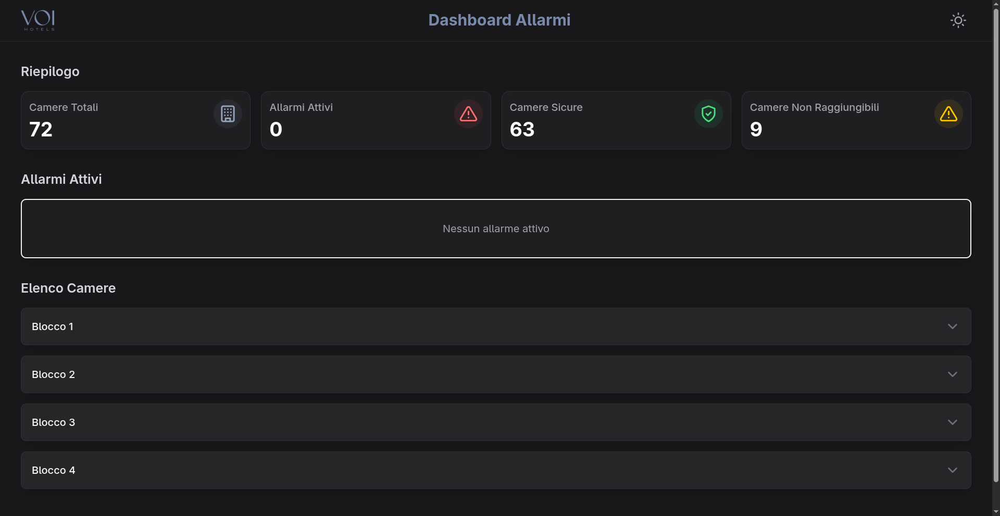
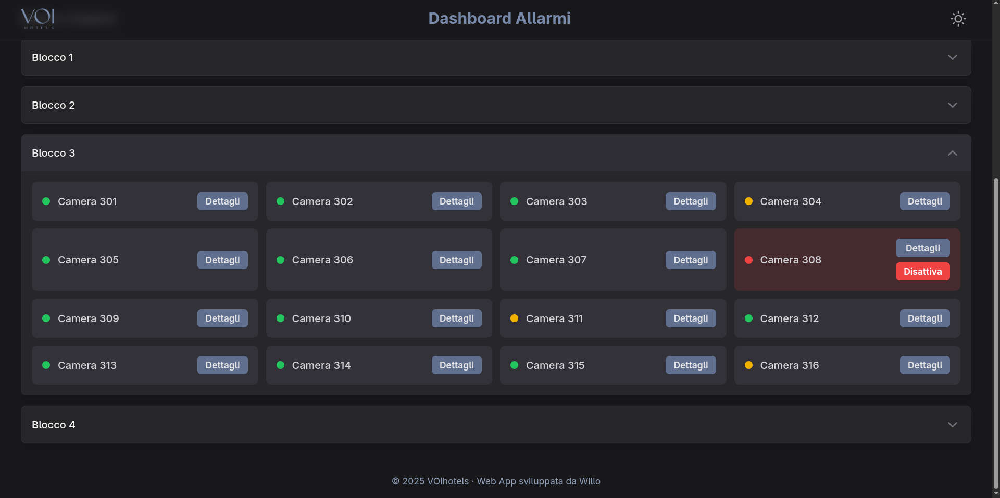
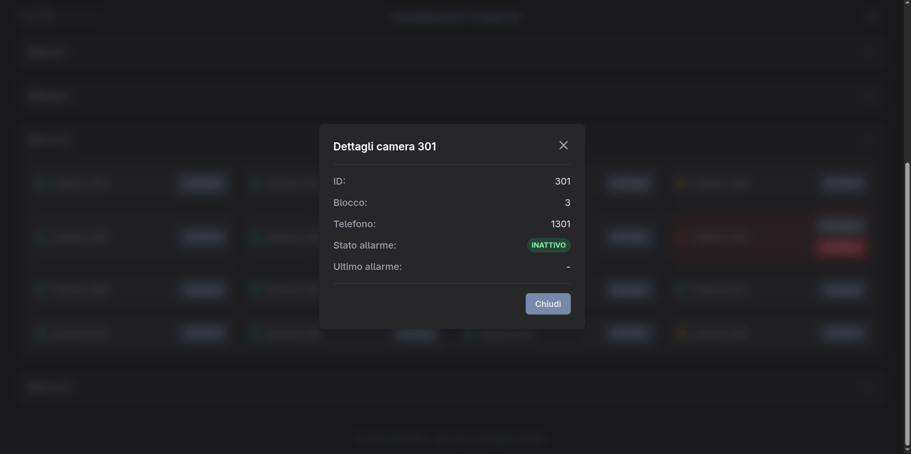
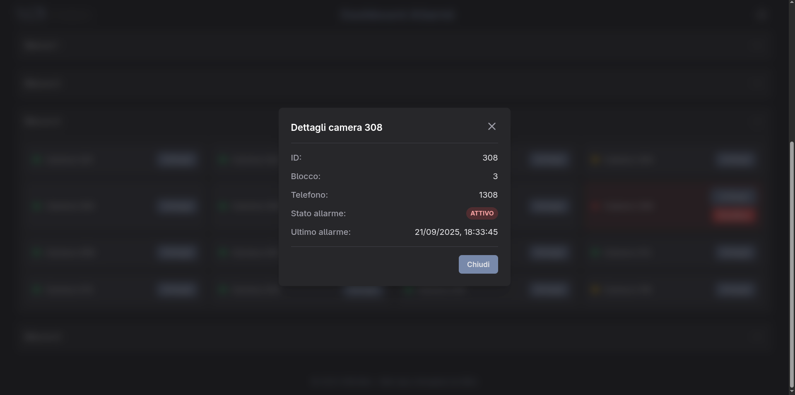
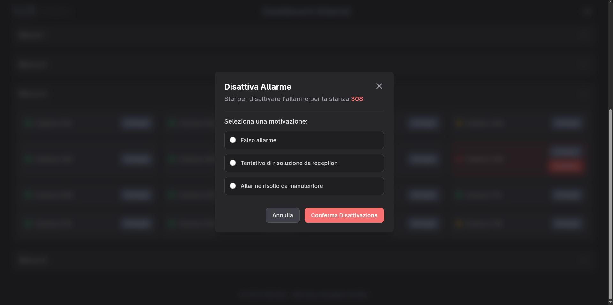

# Alarm Dashboard System

A real-time system to monitor and manage the bathroom alarms in hotel rooms. Each room has a pull cord connected to a **Shelly** device. When a guest pulls the cord, the backend shows the alarm on a web dashboard and starts a phone call between the reception and the room through the **Wildix PBX**.

The system has three parts, each in its own Docker container:

-   **Frontend** (`alarms-frontend`): a **React** dashboard to see and turn off alarms.
-   **Backend** (`alarms-backend`): a **Node.js/Express** server that receives the signals from the Shelly devices, sends real-time updates to the dashboard via WebSockets and calls the Wildix API.
-   **Database** (`redis-db`): a **Redis** instance that stores rooms and alarm statuses.

## Features

-   **Real-time Monitoring**: the dashboard shows the status of every alarm (`on`, `off`, `down`). The backend pushes every change via WebSockets.
-   **Alarm Management**: users can see the active alarms, open the details of each room (ID, block, phone number, alarm status, last activation) and turn off an alarm by choosing a reason. Every action is logged.
-   **Automated Phone Calls**: when an alarm turns on, the backend calls the Wildix PBX API. The PBX rings the reception first and, when the reception answers, it calls the room.
-   **Browser Notifications**: the dashboard shows a desktop notification for every new alarm, even when the tab is not in the foreground.
-   **Device Health Checks**: every 30 seconds the backend checks if each Shelly device is reachable. Unreachable devices are marked as `down`; they go back to `off` when they are reachable again.
-   **Self-monitoring**: a `GET /health` endpoint, Docker healthchecks and a Redis watchdog that restarts the backend if it loses the connection to Redis.
-   **Device Authorization**: the backend accepts alarm requests only from the IP addresses of the Shelly devices.
-   **Audit Log**: every alarm event is written to `backend/logs/alarm-logs.txt`.
-   **Device Utilities**: scripts to configure the Shelly devices and update their firmware.
-   **Light/Dark Theme**: the UI supports both themes and remembers the user's choice.

## Screenshots

**Dashboard**: the summary (total rooms, active alarms, safe rooms, unreachable devices), the active alarms and the rooms grouped by block.



**Room list**: each room shows its status with a colored dot: green for no alarm (`off`), red for an active alarm (`on`), yellow for an unreachable device (`down`). Rooms with an active alarm also show the **Disattiva** button.



**Room details**: ID, block, phone number, alarm status and date of the last alarm.

| No alarm | Active alarm |
| -------- | ------------ |
|  |  |

**Turn off an alarm**: the user must choose a reason, which is written in the log.



## How It Works

```
Guest pulls the cord
        │
        ▼
Shelly device ── GET /rooms/:id/alarm/on ──▶ Backend
                                               │
                     ┌─────────────────────────┼──────────────────────────┐
                     ▼                         ▼                          ▼
             Wildix PBX API             Redis (status "on")      WebSocket "alarm_on"
                     │                                                    │
     rings Reception, then the Room                                       ▼
                                                                  Dashboard + notification
```

1.  The guest pulls the cord. The Shelly device calls the backend endpoint for that room.
2.  The backend saves the new status in Redis, writes the log and sends an `alarm_on` message to all connected dashboards.
3.  The backend calls the Wildix API with the room phone number (see [Wildix Phone Calls](#wildix-phone-calls)).
4.  The receptionist turns off the alarm from the dashboard and picks a reason. The backend saves the status, writes the log and sends the updated room list to all dashboards.

### Cord actions

| Action on the cord        | Shelly event       | Result          |
| ------------------------- | ------------------ | --------------- |
| Pull once                 | `shortpush`        | Alarm **on**    |
| Pull twice                | `double_shortpush` | Alarm **on**    |
| Pull and hold             | `longpush`         | Alarm **on**    |
| Pull three times          | `triple_shortpush` | Alarm **off**   |

Turning off the alarm with the cord is meant for emergencies only. The normal way is the dashboard, because it logs the reason.

### Wildix Phone Calls

When an alarm turns on, the backend sends a `POST` request to `PBX_URL` (the Wildix `/api/v1/Calls` endpoint) with Basic authentication and the room phone number in the body (`number=<phone>`).

The credentials belong to the reception user, so the PBX:

1.  rings the reception phone;
2.  when the reception answers, calls the room phone;
3.  when the room answers, connects the two calls.

> The Wildix PBX needs at least the **Essential** license to use the API. See the [Wildix API docs](https://docs.wildix.com/api-reference/rest/wms/pbx/#/operations/postCall).

## Supported Devices

The system works with a mix of two Shelly models, configured locally (no Shelly Cloud) and reached over the local network via their HTTP API:

-   **Shelly i3** (Gen1): legacy REST API (e.g. `http://<ip>/status`, `http://<ip>/settings/input/<channel>`).
-   **Shelly Plus i4** (Gen2): JSON-RPC 2.0 API (e.g. `http://<ip>/rpc/Shelly.GetStatus`).

The configuration and firmware update scripts use the Gen1 API, so they work only on the Shelly i3. Configure the Shelly Plus i4 devices from their web interface (`http://<device-ip>`). See [Device Utility Scripts](#device-utility-scripts) for details.

## Tech Stack

-   **Frontend**: React 19, Vite, TypeScript, Tailwind CSS, Nginx (production)
-   **Backend**: Node.js 22, Express 5, TypeScript, WebSockets (`ws`), Redis 8.2, TSX (development)
-   **Tooling**: ESLint
-   **Deployment**: Docker, Docker Compose

## Getting Started

You need **Docker** and **Docker Compose**. Backend and frontend have separate `docker-compose.yml` files, so you start them separately.

1.  **Clone the repository:**
    ```bash
    git clone https://github.com/Willo-S-R-L/alarms.git
    cd alarms
    ```

2.  **Configure the backend:**
    Create `backend/.env` with the variables listed in [Backend Environment Variables](#backend-environment-variables).

3.  **Create the room data:**
    Create `backend/src/db/data.json` with the list of rooms and their Shelly devices. The file is not in the repository (it is in `.gitignore`). See the format in [Room Data](#room-data-datajson).

4.  **Start the backend and Redis:**
    ```bash
    cd backend
    docker compose up -d
    ```

5.  **Populate Redis (first start only):**
    Redis must be running before you run this script. The script **deletes all data** in Redis and loads `data.json` again.
    ```bash
    docker exec -it alarms-backend npx tsx src/utils/populate-redis.ts
    ```

6.  **Configure the frontend:**
    Create `frontend/.env` (see [Frontend Environment Variables](#frontend-environment-variables)).

7.  **Start the frontend:**
    ```bash
    cd ../frontend
    docker compose up -d
    ```

8.  **Open the application:**

    | Service              | Address                    | Notes                                                    |
    | -------------------- | -------------------------- | -------------------------------------------------------- |
    | Frontend dashboard   | `http://<host>:8080`       |                                                          |
    | Backend API          | `http://<host>:3000`       | Only for Shelly devices: other IPs get `403 Forbidden`   |
    | WebSocket server     | `ws://<host>:3000`         | Used by the dashboard                                    |
    | Redis                | `127.0.0.1:6379`           | Only from the host: not reachable from the local network |

## Configuration

### Backend Environment Variables

Create a `.env` file in the `backend` directory:

```env
# Server Configuration
PORT=3000
SERVER_IP=server_ip

# Regex for authorizing alarm device IPs (e.g. ^192\.168\.1\.\d{1,3}$)
IP_REGEX=ip_regex

# Wildix PBX API for phone calls
PBX_URL=https://subdomain.wildixin.com:port/api/v1/Calls
PBX_USER=your_username
PBX_PWD=your_password

# Redis Configuration
REDIS_HOST=redis
REDIS_PORT=6379
```

| Variable     | Description                                                                                                       |
| ------------ | ----------------------------------------------------------------------------------------------------------------- |
| `PORT`       | Server port. With Docker keep `3000`, because `docker-compose.yml` publishes port `3000`.                         |
| `SERVER_IP`  | IP address of the server. The configuration scripts use it to build the callback URLs set on the Shelly devices. |
| `IP_REGEX`   | Regex that the device IP must match. If it is missing, the device requests get no answer.                        |
| `PBX_URL`    | URL of the Wildix `/api/v1/Calls` endpoint.                                                                       |
| `PBX_USER`   | Username of the Wildix user that starts the calls (the reception).                                               |
| `PBX_PWD`    | Password of the Wildix user.                                                                                      |
| `REDIS_HOST` | Redis host. With Docker use the service name in `docker-compose.yml` (`redis`). Default: `localhost`.             |
| `REDIS_PORT` | Redis port. Default: `6379`.                                                                                      |

The `.env` file is not copied into the backend image (see `.dockerignore`), so the Wildix credentials do not end up in it. After a change to `.env`, recreate the container with `docker compose up -d`: a rebuild is not needed.

### Frontend Environment Variables

Create a `.env` file in the `frontend` directory with the backend address that the **browser** will use:

```env
VITE_SERVER_IP=backend_ip
VITE_SERVER_PORT=3000
```

If the variables are missing, the dashboard connects to `ws://localhost:3000`, which works only when the browser runs on the same machine as the backend.

Vite reads these variables at **build time** and writes them into the bundle. After a change, run `npm run build` again or rebuild the Docker image.

### Room Data (`data.json`)

`backend/src/db/data.json` contains an array of rooms. The populate script loads it into Redis. The file is in `.gitignore`, so you must create it. With Docker, the file is copied into the image at build time: after a change, rebuild the image (`docker compose up --build -d`) and run the populate script again.

Each room has this structure:

-   **`id`**: unique room ID. It **must have 3 digits** (e.g. `"101"`): the backend ignores keys that do not match `room:<3 digits>`.
-   **`block`**: building block (`"1"` to `"4"`). The dashboard groups rooms by block.
-   **`phone`**: phone number of the room, used for the Wildix call.
-   **`alarm`**: the Shelly device configuration:
    -   **`ip`**: IP address of the device.
    -   **`inputChannel`**: input channel of the device connected to the cord.
    -   **`status`**: initial alarm status (`"off"`).
    -   **`lastActivation`**: date of the last activation (empty at the start).

**Example:**
```json
[
  {
    "id": "101",
    "block": "1",
    "phone": "1101",
    "alarm": {
      "ip": "192.168.1.101",
      "inputChannel": "0",
      "status": "off",
      "lastActivation": ""
    }
  }
]
```

In Redis, each room is stored in two Hashes:

-   `room:<id>`: `id`, `block`, `phone` and `alarm` (the key of the alarm hash);
-   `room:<id>:alarm`: `ip`, `inputChannel`, `status`, `lastActivation`.

## Backend

### API Endpoints

The Shelly devices call these endpoints:

-   `GET /rooms/:id/alarm/on`: turns on the alarm of the room, calls the room through Wildix and sends `alarm_on` to the dashboards.
-   `GET /rooms/:id/alarm/off`: turns off the alarm of the room with the reason "Allarme risolto da manutentore".

Both endpoints answer `204 No Content`. Requests from IP addresses that do not match `IP_REGEX` get `403 Forbidden` (`authorizeDevice` middleware).

*Note: these endpoints use GET to change the server state because the Shelly devices can only send GET requests. The responses have `Cache-Control: no-store` and `Expires: 0` headers to avoid caching.*

The backend also exposes a health endpoint for the Docker healthcheck and for external monitoring tools. It is not restricted by `IP_REGEX` and returns no sensitive data:

-   `GET /health`: sends a `PING` to Redis (2 seconds timeout). It answers `200 {"status":"ok","redis":"up"}` when Redis answers, otherwise `503 {"status":"error","redis":"down"}`.

### WebSocket Messages

The server sends the full room list when a client connects and pushes every status change. A heartbeat (ping every 3 seconds) closes broken connections.

| Type         | Direction          | Payload                                  | When                                                                         |
| ------------ | ------------------ | ---------------------------------------- | ---------------------------------------------------------------------------- |
| `room_list`  | server → clients   | `rooms`                                  | When a client connects, and to all clients after an alarm is turned off      |
| `alarm_on`   | server → clients   | `roomId`, `status`, `lastActivation`     | When an alarm turns on                                                       |
| `alarm_down` | server → clients   | `roomId`, `status`                       | When a device is unreachable                                                 |
| `alarm_off`  | client → server    | `roomId`, `reason`                       | When a user turns off an alarm from the dashboard                            |
| `error`      | server → clients   | `info`                                   | When the server creates a message with an unknown type                       |

### Device Health Checks

Every 30 seconds the backend sends an HTTP HEAD request to each device. A device that does not answer with `200` (Shelly i3) or `405` (Shelly Plus i4) is marked as `down`. When it is reachable again, its status goes back to `off`.

### Redis Watchdog

Every 30 seconds the backend sends a `PING` to Redis. After 3 failed checks in a row (about 90 seconds without Redis), the process stops with exit code `1` and Docker restarts the container (`restart: unless-stopped`) with a new connection. The backend logs every failed check (`Redis watchdog: redis is not answering (1/3)`) and the stop.

This replaces the manual `docker restart alarms-backend` needed when the backend lost the connection to Redis and did not recover it. If Redis stays down, the backend restarts about every 90 seconds until Redis is back: without Redis it cannot work anyway.

### Device Utility Scripts

The scripts are in `backend/src/utils/`. In the Docker container they are already compiled in `dist/src/utils/`, and the environment variables come from `docker-compose.yml`:

```bash
docker exec -it alarms-backend bash

node dist/src/utils/config-alarm.js 119    # configure the device of one room
node dist/src/utils/config-all-alarms.js   # configure the devices of all rooms
node dist/src/utils/update-alarms.js       # update the firmware of all devices
```

To run them locally, use `npx tsx --env-file=.env src/utils/<script>.ts` from the `backend` directory.

-   **`config-alarm.ts <roomId>`** and **`config-all-alarms.ts`**: set the action URLs on the device input channel (`http://<ip>/settings/input/<channel>`):

    | Parameter              | URL                                                  |
    | ---------------------- | ---------------------------------------------------- |
    | `shortpush_url`        | `http://<SERVER_IP>:<PORT>/rooms/<id>/alarm/on`      |
    | `longpush_url`         | `http://<SERVER_IP>:<PORT>/rooms/<id>/alarm/on`      |
    | `double_shortpush_url` | `http://<SERVER_IP>:<PORT>/rooms/<id>/alarm/on`      |
    | `triple_shortpush_url` | `http://<SERVER_IP>:<PORT>/rooms/<id>/alarm/off`     |

-   **`update-alarms.ts`**: checks `http://<ip>/ota` on each device and starts the firmware update when one is available.

-   **`populate-redis.ts`**: deletes all data in Redis and loads `src/db/data.json`.

⚠️ The configuration and update scripts use the Shelly **Gen1** API, so they work only on the **Shelly i3**. On the **Shelly Plus i4** (Gen2, JSON-RPC API) they fail: set the same action URLs from the device web interface (`http://<device-ip>`).

`config-all-alarms.ts` and `update-alarms.ts` report the error of each device (offline, Shelly Plus i4, …) with the room and the IP, then continue with the next device. Check the output to find the devices to configure or update by hand.

## Frontend

The dashboard connects to the backend via WebSocket (`ws://VITE_SERVER_IP:VITE_SERVER_PORT`) and updates the UI on every message (`room_list`, `alarm_on`, `alarm_down`). If the connection drops, it tries to reconnect every 3 seconds.

Main components:

-   **`Summary`**: total rooms, active alarms, safe rooms and unreachable devices.
-   **`ActiveAlarms`**: the active alarms with their activation time, from the most recent to the oldest.
-   **`RoomList`**: rooms grouped by block (1, 2, 3, 4) in collapsible sections and sorted by phone number. Each room is a `RoomCard`.
-   **`RoomDetailsModal`**: ID, block, phone number, alarm status and last activation of a room.
-   **`DeactivationAlarmModal`**: asks for a reason before turning off an alarm: "Falso allarme", "Tentativo di risoluzione da reception" or "Allarme risolto da manutentore". The backend logs the reason.

Other details:

-   **Theme**: a toggle in the header. The choice is saved in `localStorage`. A script in `index.html` applies the theme before React renders, to avoid a flash of the wrong theme.
-   **Notifications**: the dashboard uses the Notification API. The browser asks for permission at the first alarm.

## Local Development

You need Node.js 22 and npm. The backend also needs a running Redis instance.

### Backend

```bash
cd backend
npm install
npx tsx --env-file=.env src/utils/populate-redis.ts   # first start only
npm run dev
```

Before you start, create `.env` (see [Backend Environment Variables](#backend-environment-variables)) and `src/db/data.json` (see [Room Data](#room-data-datajson)).

⚠️ The populate script runs `FLUSHDB` first: it **deletes all data** in Redis, including the current alarm statuses.

| Script               | Description                                                                                                                      |
| -------------------- | -------------------------------------------------------------------------------------------------------------------------------- |
| `npm run dev`        | Starts the development server with `tsx` and restarts it on file changes.                                                       |
| `npm run build`      | Compiles TypeScript to JavaScript in `dist/`.                                                                                    |
| `npm run start`      | Starts the compiled application (`dist/src/server.js`) with the local `.env` file. The Docker image does not use it: it runs `node` directly. |
| `npm run lint`       | Checks the code with ESLint.                                                                                                     |
| `npm run type-check` | Checks the types without creating files.                                                                                         |

### Frontend

```bash
cd frontend
npm install
npm run dev
```

Before you start, create `.env` (see [Frontend Environment Variables](#frontend-environment-variables)). The application is available at the address shown in the terminal (usually `http://localhost:5173`).

| Script            | Description                                                              |
| ----------------- | ------------------------------------------------------------------------ |
| `npm run dev`     | Starts the Vite development server with Hot Module Replacement (HMR).    |
| `npm run build`   | Checks the types and builds the application for production in `dist/`. |
| `npm run lint`    | Checks the code with ESLint.                                             |
| `npm run preview` | Serves the production build locally.                                     |

## Docker Deployment

### Backend

`backend/docker-compose.yml` defines two services:

-   **`redis`** (`redis-db`): Redis `8.2` with AOF persistence. The version is pinned to avoid unwanted upgrades: Redis cannot read data files written by a newer version, so change the version only on purpose and after a backup of `redis_data`. Port `6379` is published only on `127.0.0.1`: Redis has no password, so it must not be reachable from the local network. From the host, use `redis-cli` or `docker exec -it redis-db redis-cli`.
-   **`app`** (`alarms-backend`): the backend, built from the `Dockerfile`. It receives the variables of `.env` through `env_file` and publishes port `3000`.

Both services have a healthcheck:

-   **`redis`**: `redis-cli ping` every 10 seconds.
-   **`app`**: calls `GET /health` every 30 seconds (with `node`, because the image has no `curl` or `wget`).

`docker ps` shows the result in the `STATUS` column (`healthy` or `unhealthy`). The healthcheck only shows the status: the restart after a lost Redis connection is done by the [Redis watchdog](#redis-watchdog).

With `depends_on: condition: service_healthy`, `docker compose up` starts the backend only when Redis answers. This condition is not applied when Docker restarts the containers by itself (for example after a server reboot): if the backend starts before Redis, it stops and Docker restarts it until Redis is ready.

### Frontend

-   The `Dockerfile` uses a multi-stage build: the first stage builds the React application, the second copies the static files into an **Nginx** image.
-   `frontend/docker-compose.yml` runs the container (`alarms-frontend`) and publishes Nginx port `80` on port **8080**.
-   The `.env` file is copied into the build stage, so create it before you build the image. After a change to `.env`, rebuild the image (`docker compose up --build -d`).

### Data Persistence

`backend/docker-compose.yml` uses bind mounts, not Docker-managed volumes:

-   Redis data: `backend/redis_data/` (AOF persistence is on)
-   Logs: `backend/logs/`

### Automatic Restart

All services use `restart: unless-stopped`. Docker restarts them after a crash or a server reboot, but not after a manual `docker stop`.

External monitoring tools can call `http://<host>:3000/health` (see [API Endpoints](#api-endpoints)).

### Useful Docker Commands

```bash
docker compose up -d           # start the services in background (build images if missing)
docker compose up --build -d   # rebuild the images and start (use it after code changes)
docker compose stop            # stop the containers without removing them
docker compose down            # stop and remove containers and networks (bind-mounted data is kept)
docker compose -f <file> up    # use a different compose file
docker ps -a                   # list all containers
docker logs -f <container>     # follow the logs of a container
docker exec -it <container> bash
docker image prune             # remove dangling images
```

## Maintenance

### Logs

The backend writes alarm events to `backend/logs/alarm-logs.txt`, with date, room, status and description:

-   alarm on
-   repeated alarm (a new alarm in a room where the alarm is already on)
-   alarm off (with the reason)
-   alarm unreachable
-   alarm reachable again

Example of useful commands:
```bash
grep 'disattivato' backend/logs/alarm-logs.txt   # only turned-off alarms
grep '22/04' backend/logs/alarm-logs.txt         # only one day
tail -f backend/logs/alarm-logs.txt              # follow in real time
```

The container runs as the `node` user (UID `1000`). If the backend cannot write the log file, give the folder to that user:
```bash
chown -R 1000:1000 backend/logs/
```

`clear-logs.sh` deletes the log file inside the container. You can run it as a cron job; the instructions are in the script.

## Troubleshooting

-   **Disk full because of Docker logs**: Docker container logs have no size limit by default. The `docker-compose.yml` files of this project already set a limit (3 files of 100 MB per container). To set the same limit for every other container on the host, edit `/etc/docker/daemon.json`, then run `systemctl restart docker` and recreate the containers:
    ```json
    {
      "log-driver": "json-file",
      "log-opts": { "max-size": "100m", "max-file": "3" }
    }
    ```
-   **Redis keeps restarting with `Bad file format reading the append only file`**: an incremental AOF file is corrupted (for example, because the disk was full). Stop `redis-db`, rename the corrupted `*.incr.aof` file in `backend/redis_data/appendonlydir/`, edit `appendonly.aof.manifest` so that it lists only the base file, then start `redis-db` again.
-   **Dashboard shows no data and the backend logs `Redis connection error`**: the backend lost the connection to Redis. The Redis watchdog restarts the backend by itself after about 90 seconds (see [Redis Watchdog](#redis-watchdog)). If the problem continues, check that `redis-db` is running and `healthy` with `docker ps`.
-   **Containers do not start inside a Proxmox LXC container after a Docker update** (`open sysctl net.ipv4.ip_unprivileged_port_start file: ... permission denied`): in `/etc/pve/lxc/<id>.conf` on the Proxmox host, set `features: nesting=1,keyctl=1` and `lxc.apparmor.profile: unconfined`, then stop and start the LXC container. This removes the AppArmor protection: running Docker in a dedicated VM avoids the problem.

## Project Structure

```
alarms/
├── backend/                  # Node.js, Express and WebSocket backend
│   ├── logs/                 # alarm log file (bind mount)
│   ├── src/
│   │   ├── controllers/      # Express route handlers
│   │   ├── db/               # Redis client, repositories and initial data (data.json)
│   │   ├── middleware/       # Express middleware, like the device authorization filter
│   │   ├── routes/           # Express routes that map endpoints to controllers
│   │   ├── services/         # business logic: rooms, Wildix calls, health checks, Redis watchdog
│   │   ├── types/            # TypeScript type definitions
│   │   ├── utils/            # logger, device configuration/update scripts and DB population
│   │   ├── websocket/        # WebSocket server, alarm handlers and messages
│   │   └── server.ts         # entry point: starts Express, the WebSocket server and the checks
│   ├── Dockerfile
│   └── docker-compose.yml
├── frontend/                 # React, Vite and Tailwind CSS dashboard
│   ├── src/
│   │   ├── components/       # UI components (Summary, RoomList, modals, icons…)
│   │   ├── App.tsx           # WebSocket connection and app state
│   │   └── main.tsx          # entry point
│   ├── index.html
│   ├── Dockerfile
│   └── docker-compose.yml
├── screenshots/              # screenshots of the dashboard used in this README
├── clear-logs.sh             # script to delete the alarm log file (for cron)
└── README.md
```
